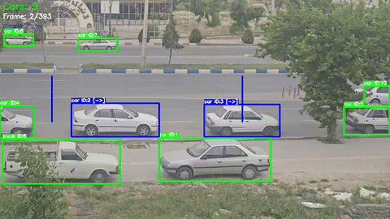
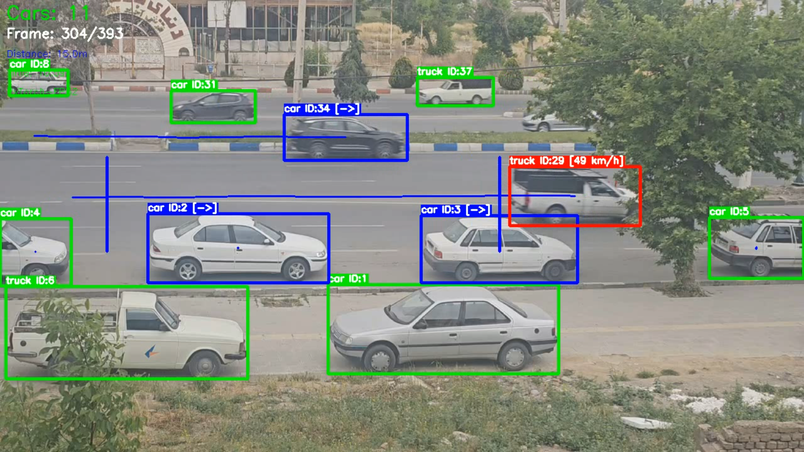
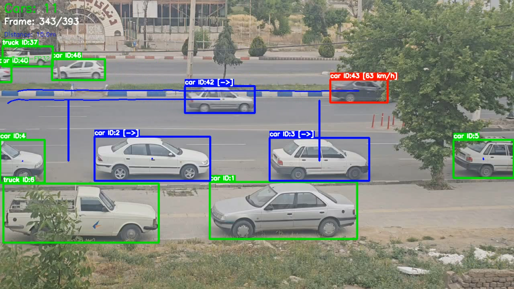

# Car Tracking and Speed Estimation

Vehicle detection, BoT-SORT tracking, optional OSNet ReID, and speed estimation from a fixed camera. Detection uses pretrained YOLOv8m weights. This project does not train or fine-tune YOLO.

Speed is the time a track takes to cross two vertical lines, converted with a real-world distance:

```text
speed_kmh = (distance_meters / travel_time_seconds) * 3.6
```

The script requires an NVIDIA GPU. If CUDA is not available it raises `GPU is not available.`

## Result







`result_output.txt` is the console log of one run with ReID off. The configuration block in that file is:

| Item | Logged value |
| --- | --- |
| Input | `/app/input/bb.mp4` |
| ReID | false |
| Line 1 | x=170, y=250 to 400 |
| Line 2 | x=795, y=250 to 400 |
| Clear measurements after | x=900 |
| Real distance | 15 m |
| GPU | NVIDIA GeForce GTX 1660 Ti |
| Video | 1280×720, 28.94 FPS, 393 frames |

Benchmark printed for that run:

| Metric | Value |
| --- | --- |
| Frames | 393 |
| Maximum vehicles in a frame | 15 |
| Total processing time | 17.59 s |
| Average latency | 44.75 ms |
| Median latency | 30.99 ms |
| P95 latency | 35.43 ms |
| Average FPS | 22.35 |
| Median FPS | 32.27 |

Speeds written in that log include 55.8, 57.9, 48.8, 62.5, and 41.1 km/h. The benchmark banner in `main.py` always prints `PyTorch + ReID FP32`; the configuration lines above it are the ones that show whether ReID was on.

Sample videos: `output/result_bb_reid.mp4` and `output/result_bb_noreid.mp4`. The source clip used by `get_coordinates.py` and by the logged run is `bb.mp4`.

## Detection and tracking

YOLOv8m (`yolov8m.pt`) runs in PyTorch FP32. The tracker is BoT-SORT from BoxMOT. Kept classes are the COCO ids in `main.py`:

| Class id | Label |
| ---: | --- |
| 2 | car |
| 3 | motorcycle |
| 5 | bus |
| 7 | truck |

Detection confidence is 0.35 and the IoU threshold is 0.5. Optional appearance features come from `osnet_x0_25_msmt17.pt`. The code default for `USE_REID` is `true`. The logged benchmark above used `false`.

`get_coordinates.py` opens `bb.mp4` in an OpenCV window so the measurement lines can be clicked. It is a local helper, not the Docker entrypoint.

## Run

Host requirements: Docker, an NVIDIA GPU and driver, and the NVIDIA Container Toolkit. Python packages are inside the image. The Dockerfile copies `main.py`, `yolov8m.pt`, and `osnet_x0_25_msmt17.pt`.

Put the input video in `input/`. The processed file is written to `output/`.

Linux:

```bash
docker build -t car-tracking .
docker run --rm --gpus all \
  -v "$(pwd)/input:/app/input" \
  -v "$(pwd)/output:/app/output" \
  -e VIDEO_PATH=/app/input/bb.mp4 \
  -e OUTPUT_PATH=/app/output/result.mp4 \
  -e USE_REID=false \
  car-tracking:latest
```

Windows PowerShell:

```powershell
docker build -t car-tracking .
docker run --rm --gpus all `
  -v "${PWD}/input:/app/input" `
  -v "${PWD}/output:/app/output" `
  -e VIDEO_PATH=/app/input/bb.mp4 `
  -e OUTPUT_PATH=/app/output/result.mp4 `
  -e USE_REID=false `
  car-tracking:latest
```

Omitting the `LINE_*` and `REAL_DISTANCE_METERS` variables uses the defaults in `main.py`, which are the values in the table above. Set `USE_REID=true` to enable OSNet. ReID increases the work per frame.

| Variable | Default | Meaning |
| --- | --- | --- |
| `VIDEO_PATH` | `/app/input/video.mp4` | Input path inside the container |
| `OUTPUT_PATH` | `/app/output/result.mp4` | Output path inside the container |
| `USE_REID` | `true` | OSNet appearance features |
| `LINE1_X`, `LINE1_Y1`, `LINE1_Y2` | 170, 250, 400 | First vertical line |
| `LINE2_X`, `LINE2_Y1`, `LINE2_Y2` | 795, 250, 400 | Second vertical line |
| `LINE_OUT` | 900 | Drop a track from the measurement state after this x |
| `REAL_DISTANCE_METERS` | 15 | Distance between the two lines |

Those defaults match `result_output.txt`. Another camera needs its own line positions and distance. A wrong distance scales every speed by the same factor.

## Project files

```text
car_tracking_docker/
├── Dockerfile
├── main.py
├── get_coordinates.py
├── requirements.txt
├── yolov8m.pt
├── osnet_x0_25_msmt17.pt
├── bb.mp4
├── result_1.png
├── result_2.png
├── result_output.txt
└── output/
    ├── result_bb_reid.gif
    ├── result_bb_reid.mp4
    └── result_bb_noreid.mp4
```

`input/` and `output/` mounts used at runtime are gitignored, except the sample files already stored under `output/` in this tree. Do not commit a `docker save` tar; `.gitignore` excludes `car-tracking.tar`.

## Limits

- YOLO is pretrained. Identity and speed behavior were not measured against a labeled tracking or speed dataset.
- The FPS numbers are one 393-frame clip on a GTX 1660 Ti with ReID off.
- Speed is only as accurate as the line placement and `REAL_DISTANCE_METERS` for that camera.
